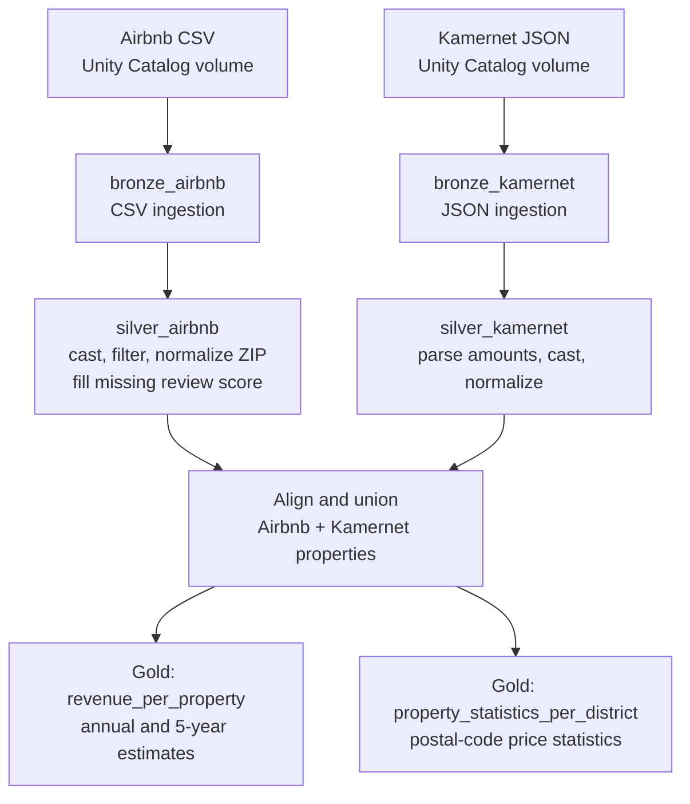
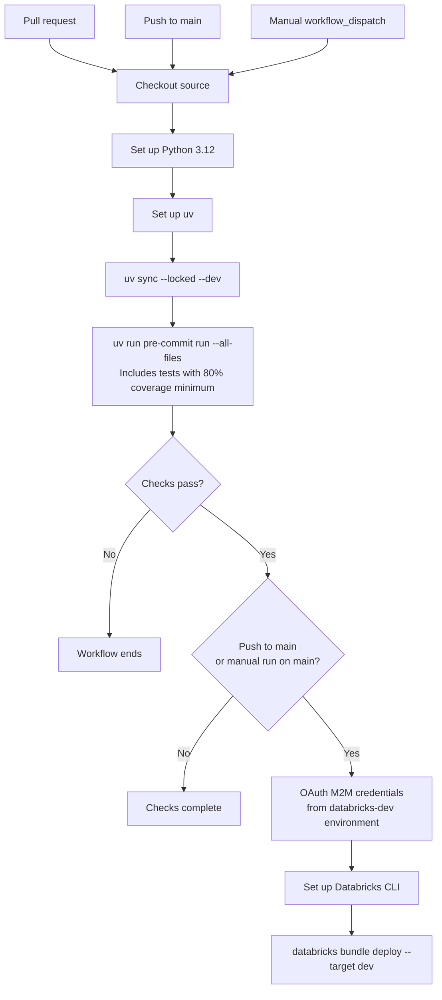

# Data pipeline and CI/CD

## Data flow

The Spark Declarative Pipeline loads both sources and derives bronze, silver,
and gold materialized views. Each output is published to the configured schema;
prefixes distinguish the intermediate datasets.

The gold tables are published to the configured catalog and gold schema. The
dashboard reads from that schema.

## CI/CD pipeline

The `checks` job runs for pull requests, pushes to `main`, and manual
`workflow_dispatch` runs. Deployment waits for checks to pass and is restricted
to `main` pushes or manual runs on `main`.

